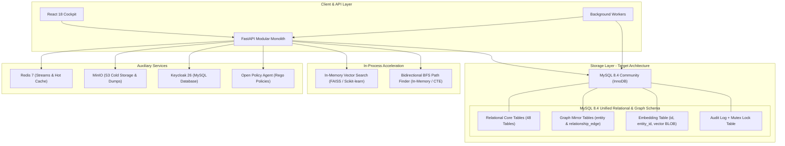
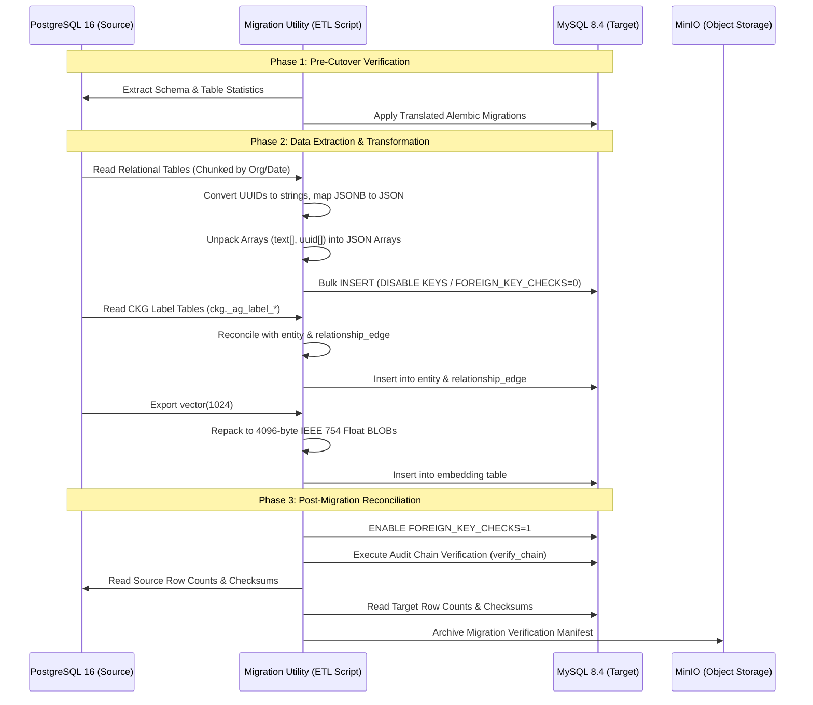
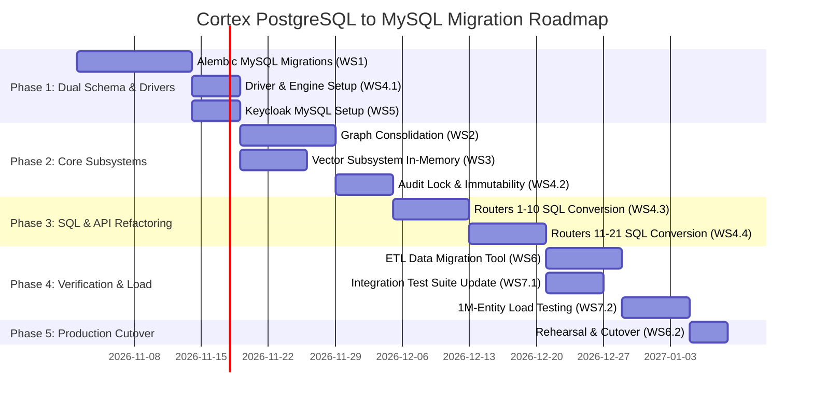

# Cortex PostgreSQL-to-MySQL Migration Feasibility Analysis Report

> **Historical record (undated; file last saved 2026-10-26).** Preserved for reference and superseded by the current documents in `docs/CORTEX_DOCUMENTATION_INDEX.md`. Its status, counts and blockers describe that date only. Machine-specific paths were replaced with placeholders such as `<repo>`; nothing else was changed.


**Document ID:** CRTX-MIG-MYSQL-2026-001  
**Project:** Inspironics MERIS — Capital Cortex™ Module  
**Source Platform:** PostgreSQL 16.x (with Apache AGE 1.5.0, pgvector 0.8.0, pg_trgm, pgcrypto)  
**Target Platform:** MySQL 8.4 Community Edition  
**Investigation Date:** October 2026  
**Status:** Complete Feasibility & Architecture Study  

---

## 1. Executive Summary

### 1.1 Feasibility Verdict

**FEASIBLE WITH SIGNIFICANT RE-ENGINEERING**

Migrating the Cortex module of the MERIS project from PostgreSQL 16 to MySQL 8.4 Community is technically achievable while preserving all business functionality, but it requires substantial architectural and code-level re-engineering. It is **not** a drop-in database replacement.

### 1.2 Core Findings Summary

1. **Absence of an ORM Abstraction Layer:**  
   Cortex does **not** use the SQLAlchemy Object-Relational Mapping (ORM) declarative layer (`declarative_base`, `Mapped`, `relationship`). Instead, 100% of database interactions are written in **raw SQL strings** executed asynchronously via `session.execute(text("..."), params)` and migrated via raw SQL in Alembic (`op.execute(...)`). There are **over 250 raw SQL queries** across the codebase containing PostgreSQL-specific syntax that will immediately fail on MySQL.

2. **Apache AGE (Capital Knowledge Graph - CKG):**  
   Apache AGE is an extension available exclusively on PostgreSQL. It cannot run on MySQL. However, the codebase reveals a crucial architectural asset: **the graph is already 100% mirrored in relational tables** (`entity` and `relationship_edge`). Furthermore, due to severe performance bottlenecks discovered during 1M-node load testing (documented in [LOAD_TEST.md](file:///<home>/OneDrive%20-%20Inspironics%20India/Insp%20Total%20Work/cortex/Capital_Cortex/docs/LOAD_TEST.md) and Decision [D-076](file:///<home>/OneDrive%20-%20Inspironics%20India/Insp%20Total%20Work/cortex/Capital_Cortex/docs/DECISIONS.md#L283)), neighborhood queries and shortest-path finding were **already moved off Cypher** to recursive/BFS SQL algorithms. Graph operations can therefore be completely consolidated into MySQL relational tables (`entity` and `relationship_edge`) without requiring an external graph database, provided the raw Cypher admin console is replaced or emulated.

3. **pgvector (Vector Storage and HNSW Search):**  
   Cortex uses `vector(1024)` with an HNSW cosine index. Vector similarity search is only executed in a single operational location: Copilot context retrieval in [copilot.py](file:///<home>/OneDrive%20-%20Inspironics%20India/Insp%20Total%20Work/cortex/Capital_Cortex/cortex/l5_strategy/copilot.py#L91). The vector model (`hash-tf-1024-v1`) is generated deterministically in local Python memory ([embeddings.py](file:///<home>/OneDrive%20-%20Inspironics%20India/Insp%20Total%20Work/cortex/Capital_Cortex/platform_core/embeddings.py#L19)). Standard MySQL 8.4 Community lacks an in-engine HNSW index. Embeddings must either be stored as `BLOB` (4 KB float32 arrays) with in-process vector indexing (e.g., FAISS / Scikit-learn), or offloaded to a dedicated sidecar vector store (e.g., Qdrant).

4. **SQL Incompatibilities & Critical Invariants:**  
   - **`RETURNING` Clauses:** Over 60 queries rely on `INSERT ... RETURNING id` or `UPDATE ... RETURNING ...`. MySQL 8.4 does not support `RETURNING`. Client-side UUID pre-generation in Python must be adopted across all insert paths.
   - **Partial Unique Indexes:** 8 critical unique indexes enforce business rules conditionally (e.g., `WHERE external_key IS NOT NULL`, `WHERE status = 'active'`). MySQL does not support partial indexes; functional generated columns must be introduced.
   - **PostgreSQL Arrays (`text[]`, `uuid[]`):** 16 columns across 11 tables store native arrays, queried via `= ANY(...)`, `&&` (overlap), `<@` (containment), and `cardinality()`. MySQL has no native array type; these must become JSON arrays or normalized junction tables.
   - **Triggers and Invariants (I1, I3):** Invariant I1 (provenance check) uses `jsonb_typeof()`. Invariant I3 (outbox immutability) uses `outbox_invalidate_on_edit()` with `IS DISTINCT FROM`. MySQL equivalents require `JSON_TYPE()`, `SIGNAL SQLSTATE '45000'`, and NULL-safe equality `<=>`.
   - **Advisory Locks:** `pg_advisory_xact_lock()` guarantees atomic audit log hash-chaining. MySQL's `GET_LOCK()` is session-scoped, not transaction-scoped. A dedicated row-lock mutex table must be used instead.

5. **External Dependencies (Keycloak, Backup, CI/CD):**  
   The Compose stack provisions Keycloak 26 using PostgreSQL. Keycloak 26 supports MySQL natively, requiring database configuration updates. Backup scripts (`pg_basebackup`, WAL shipping to MinIO) and integration test containers (`testcontainers.postgres`) must be redesigned for MySQL binlog replication and MySQL testcontainers.

---

## 2. Business Requirement and Target Architecture

### 2.1 Business Requirement

MERIS comprises three modules: **ASIP**, **ARIE**, and **Cortex** (as confirmed in [platform_core/__init__.py](file:///<home>/OneDrive%20-%20Inspironics%20India/Insp%20Total%20Work/cortex/Capital_Cortex/platform_core/__init__.py#L1)). ASIP and ARIE already run on MySQL. Cortex currently runs on PostgreSQL 16.

The goal is to migrate Cortex to **MySQL 8.4 Community Edition** to unify infrastructure, operational tooling, and DBA skillsets across MERIS, while strictly preserving:
- All 11 capital instrument classes and workflows.
- All non-negotiable invariants (I1: No-fabrication, I2: Explainability, I3: Governed actuation / Outbox, I4: Zero trust, I5: Provenance continuity, I6: Memory-grounded learning, I7: LLMs never compute numbers).
- Scale target: $\ge 1,000,000$ entities meeting latency SLOs (p95 $\le 3\text{ s}$ on dashboard, $\le 1\text{ s}$ on opportunities, $\le 5\text{ s}$ on graph traversals).

### 2.2 Recommended Target Architecture

To satisfy the business requirement of running relational data on MySQL while eliminating high-risk distributed dual-write transactions across disparate databases, the recommended architecture is:



- **Relational Data:** MySQL 8.4 Community (InnoDB, `utf8mb4_0900_ai_ci`).
- **Graph Data (CKG):** Fully consolidated into MySQL's existing `entity` and `relationship_edge` tables. Bounded traversals and shortest paths run via bidirectional BFS in Python or recursive CTEs. Retains 100% single-transaction ACID consistency with relational records.
- **Vector Search:** Embeddings stored as 4 KB binary float32 blobs in MySQL `embedding` table; ANN retrieval executed either via FAISS index loaded in the worker/API memory space or via an optional lightweight sidecar (Qdrant) if vector volume exceeds 1M rows.
- **Identity:** Keycloak reconfigured from PostgreSQL to MySQL.

---

## 3. Current Architecture and Evidence

### 3.1 Architectural Baseline

| Component | Current Implementation | Source Evidence |
|---|---|---|
| **Database Engine** | PostgreSQL 16.x | [infra/postgres/Dockerfile:1-4](file:///<home>/OneDrive%20-%20Inspironics%20India/Insp%20Total%20Work/cortex/Capital_Cortex/infra/postgres/Dockerfile#L1-L4) |
| **Graph Engine** | Apache AGE 1.5.0 (`ckg` graph) | [infra/postgres/init/01-extensions.sql:4](file:///<home>/OneDrive%20-%20Inspironics%20India/Insp%20Total%20Work/cortex/Capital_Cortex/infra/postgres/init/01-extensions.sql#L4), [DECISIONS.md:24-27](file:///<home>/OneDrive%20-%20Inspironics%20India/Insp%20Total%20Work/cortex/Capital_Cortex/docs/DECISIONS.md#L24-L27) |
| **Vector Engine** | pgvector 0.8.0 (`vector(1024)`, HNSW cosine) | [0001_initial.py:427-428](file:///<home>/OneDrive%20-%20Inspironics%20India/Insp%20Total%20Work/cortex/Capital_Cortex/migrations/versions/0001_initial.py#L427-L428) |
| **Text Extensions** | `pg_trgm`, `pgcrypto` | [infra/postgres/init/01-extensions.sql:2-5](file:///<home>/OneDrive%20-%20Inspironics%20India/Insp%20Total%20Work/cortex/Capital_Cortex/infra/postgres/init/01-extensions.sql#L2-L5) |
| **Driver & ORM** | `sqlalchemy[asyncio] 2.0.36`, `psycopg 3.2.3` (Raw SQL only) | [pyproject.toml:15-16](file:///<home>/OneDrive%20-%20Inspironics%20India/Insp%20Total%20Work/cortex/Capital_Cortex/pyproject.toml#L15-L16), [session.py:7](file:///<home>/OneDrive%20-%20Inspironics%20India/Insp%20Total%20Work/cortex/Capital_Cortex/platform_core/db/session.py#L7) |
| **Schema Migrations** | Alembic 1.14 (5 versions, all DDL in `op.execute()`) | [migrations/versions/](file:///<home>/OneDrive%20-%20Inspironics%20India/Insp%20Total%20Work/cortex/Capital_Cortex/migrations/versions/) |
| **Total Table Count** | 48 relational tables + 2 CKG graph parent tables | [migrations/versions/0001_initial.py](file:///<home>/OneDrive%20-%20Inspironics%20India/Insp%20Total%20Work/cortex/Capital_Cortex/migrations/versions/0001_initial.py), [0002_phase1.py](file:///<home>/OneDrive%20-%20Inspironics%20India/Insp%20Total%20Work/cortex/Capital_Cortex/migrations/versions/0002_phase1.py), [0003_phase2.py](file:///<home>/OneDrive%20-%20Inspironics%20India/Insp%20Total%20Work/cortex/Capital_Cortex/migrations/versions/0003_phase2.py), [0004_phase3.py](file:///<home>/OneDrive%20-%20Inspironics%20India/Insp%20Total%20Work/cortex/Capital_Cortex/migrations/versions/0004_phase3.py) |
| **Keycloak Database** | Shared Postgres cluster (`database: keycloak`) | [infra/docker-compose.yml:127-130](file:///<home>/OneDrive%20-%20Inspironics%20India/Insp%20Total%20Work/cortex/Capital_Cortex/infra/docker-compose.yml#L127-L130) |
| **Backup System** | WAL archiving + `pg_basebackup` + MinIO shipper | [scripts/backup.py:1-15](file:///<home>/OneDrive%20-%20Inspironics%20India/Insp%20Total%20Work/cortex/Capital_Cortex/scripts/backup.py#L1-L15), [infra/docker-compose.yml:53-80](file:///<home>/OneDrive%20-%20Inspironics%20India/Insp%20Total%20Work/cortex/Capital_Cortex/infra/docker-compose.yml#L53-L80) |

### 3.2 Evidence of Absence of ORM Models

Grep searches for `declarative_base`, `sqlalchemy.orm`, `Mapped`, and `select(` from `sqlalchemy` returned **zero** matches across the entire codebase. Every query is written as:
```python
await session.execute(text("SELECT ... FROM ... WHERE ..."), params)
```
This means there are no ORM dialect adapters to automatically translate queries from PostgreSQL to MySQL. Every single query string must be manually inspected, updated, and tested.

---

## 4. PostgreSQL-Specific Dependency Inventory

The following table documents every verified PostgreSQL-specific dependency, its location, current purpose, MySQL 8.4 compatibility, and required remediation.

| # | Dependency / Syntax | Source File & Location | Current Purpose | MySQL Compatibility | Required Remediation | Severity |
|---|---|---|---|---|---|---|
| 1 | **Apache AGE Extension & Cypher** | [platform_core/db/age.py:27](file:///<home>/OneDrive%20-%20Inspironics%20India/Insp%20Total%20Work/cortex/Capital_Cortex/platform_core/db/age.py#L27), [0001_initial.py:526](file:///<home>/OneDrive%20-%20Inspironics%20India/Insp%20Total%20Work/cortex/Capital_Cortex/migrations/versions/0001_initial.py#L526) | Loads AGE plugin, runs parameterised Cypher against `ckg` graph. | **Incompatible.** Apache AGE does not run on MySQL. | Replace with MySQL relational queries on `entity` and `relationship_edge` mirrors. | **Critical** |
| 2 | **Internal AGE Table Traversal** | [cortex/l2_representation/graph_traversal.py:34-80](file:///<home>/OneDrive%20-%20Inspironics%20India/Insp%20Total%20Work/cortex/Capital_Cortex/cortex/l2_representation/graph_traversal.py#L34-L80) | Directly queries `ckg._ag_label_vertex`, `ckg._ag_label_edge`, `agtype_out()`, `pg_class`, `tableoid`. | **Incompatible.** PostgreSQL catalog tables and AGE types do not exist in MySQL. | Rewrite traversal queries to walk `relationship_edge` and `entity` tables. | **Critical** |
| 3 | **Graph Stats XML/XPath Query** | [api/routers/graph.py:148-150](file:///<home>/OneDrive%20-%20Inspironics%20India/Insp%20Total%20Work/cortex/Capital_Cortex/cortex/l8_actuation/api/routers/graph.py#L148-L150) | Uses `query_to_xml()` and `xpath()` to count nodes/edges dynamically. | **Incompatible.** `query_to_xml` is PostgreSQL-specific. | Query `entity` and `relationship_edge` grouped by `entity_type` and `type`. | **High** |
| 4 | **pgvector Types & Operators (`<=>`, `vector`)** | [platform_core/db/vector.py:18-24](file:///<home>/OneDrive%20-%20Inspironics%20India/Insp%20Total%20Work/cortex/Capital_Cortex/platform_core/db/vector.py#L18-L24), [copilot.py:91](file:///<home>/OneDrive%20-%20Inspironics%20India/Insp%20Total%20Work/cortex/Capital_Cortex/cortex/l5_strategy/copilot.py#L91) | Stores 1024-dim embeddings; calculates cosine distance with `<=>`. | **Incompatible.** MySQL 8.4 Community has no HNSW cosine index or `<=>` operator. | Store as `BLOB` (4 KB float32 array); perform ANN in-memory via FAISS/Scikit-learn. | **Critical** |
| 5 | **HNSW Index DDL** | [0001_initial.py:427-428](file:///<home>/OneDrive%20-%20Inspironics%20India/Insp%20Total%20Work/cortex/Capital_Cortex/migrations/versions/0001_initial.py#L427-L428) | Creates index `ix_embedding_hnsw USING hnsw (vector vector_cosine_ops)`. | **Incompatible.** Syntax error on MySQL. | Drop HNSW index definition from MySQL migrations. | **Critical** |
| 6 | **`RETURNING` Clauses on INSERT/UPDATE** | 60+ locations (e.g., [graph_writer.py:43, 218](file:///<home>/OneDrive%20-%20Inspironics%20India/Insp%20Total%20Work/cortex/Capital_Cortex/cortex/l2_representation/graph_writer.py#L43), [proposals.py:134](file:///<home>/OneDrive%20-%20Inspironics%20India/Insp%20Total%20Work/cortex/Capital_Cortex/cortex/l8_actuation/proposals.py#L134)) | Returns generated IDs, updated versions, and status without roundtrip. | **Incompatible.** MySQL 8.4 syntax error 1064. | Pre-generate UUIDs in Python (`uuid.uuid4()`); query values before/after update. | **Critical** |
| 7 | **System Column `xmax = 0` (Insert vs Update)** | [graph_writer.py:218](file:///<home>/OneDrive%20-%20Inspironics%20India/Insp%20Total%20Work/cortex/Capital_Cortex/cortex/l2_representation/graph_writer.py#L218) | `RETURNING id, (xmax = 0) AS created` detects if upsert created or updated. | **Incompatible.** `xmax` is a PostgreSQL MVCC internal column. | Check record existence prior to write or inspect DBAPI `rowcount` (1=insert, 2=update). | **High** |
| 8 | **`ON CONFLICT (cols) WHERE <predicate>`** | 8 locations (e.g., [graph_writer.py:207](file:///<home>/OneDrive%20-%20Inspironics%20India/Insp%20Total%20Work/cortex/Capital_Cortex/cortex/l2_representation/graph_writer.py#L207), [alerts.py:314](file:///<home>/OneDrive%20-%20Inspironics%20India/Insp%20Total%20Work/cortex/Capital_Cortex/cortex/l8_actuation/alerts.py#L314)) | Upserts conditional on partial unique index (`WHERE col IS NOT NULL`). | **Incompatible.** MySQL syntax error; no `ON CONFLICT` and no partial index. | Rewrite as `ON DUPLICATE KEY UPDATE`; emulate partial constraint with generated column. | **Critical** |
| 9 | **`EXCLUDED.column` Syntax** | 25+ locations (e.g., [pipeline.py:104](file:///<home>/OneDrive%20-%20Inspironics%20India/Insp%20Total%20Work/cortex/Capital_Cortex/cortex/l2_representation/pipeline.py#L104), [memory_manager.py:78](file:///<home>/OneDrive%20-%20Inspironics%20India/Insp%20Total%20Work/cortex/Capital_Cortex/cortex/l3_memory/memory_manager.py#L78)) | References incoming candidate values in upsert statement. | **Incompatible.** MySQL uses `VALUES(col)` or `new_alias.col` in MySQL 8.0.20+. | Rewrite to MySQL `ON DUPLICATE KEY UPDATE col = VALUES(col)`. | **Medium** |
| 10 | **Native Array Columns (`text[]`, `uuid[]`)** | 16 columns across 11 tables (e.g., `sectors`, `emails`, `contact_ids`, `dd_tags`) | Storing multi-valued tags, emails, IDs natively in table columns. | **Incompatible.** MySQL has no native array type. | Convert to `JSON` arrays or normalize into relational junction tables. | **High** |
| 11 | **Array Operator `= ANY(...)`** | 40+ locations (e.g., [opportunities.py:65](file:///<home>/OneDrive%20-%20Inspironics%20India/Insp%20Total%20Work/cortex/Capital_Cortex/cortex/l8_actuation/api/routers/opportunities.py#L65), [entities.py:56](file:///<home>/OneDrive%20-%20Inspironics%20India/Insp%20Total%20Work/cortex/Capital_Cortex/cortex/l8_actuation/api/routers/entities.py#L56)) | Filters rows where column equals any element in passed Python list. | **Incompatible.** MySQL does not support `= ANY(array_param)`. | Replace with dynamic `IN (:id_0, :id_1, ...)` or `JSON_CONTAINS()`. | **High** |
| 12 | **Array Overlap (`&&`) & Containment (`<@`)** | [opportunities.py:71](file:///<home>/OneDrive%20-%20Inspironics%20India/Insp%20Total%20Work/cortex/Capital_Cortex/cortex/l8_actuation/api/routers/opportunities.py#L71), [tool_registry.py:439](file:///<home>/OneDrive%20-%20Inspironics%20India/Insp%20Total%20Work/cortex/Capital_Cortex/cortex/l6_agency/tool_registry.py#L439), [0001_initial.py:305](file:///<home>/OneDrive%20-%20Inspironics%20India/Insp%20Total%20Work/cortex/Capital_Cortex/migrations/versions/0001_initial.py#L305) | Tests if array shares elements (`&&`) or is a subset (`<@`). | **Incompatible.** Syntax error in MySQL. | Emulate with `JSON_OVERLAPS()` (MySQL 8.0.17+) or normalized junction tables. | **High** |
| 13 | **Array Function `cardinality()`** | 6 locations (e.g., [copilot.py:74](file:///<home>/OneDrive%20-%20Inspironics%20India/Insp%20Total%20Work/cortex/Capital_Cortex/cortex/l5_strategy/copilot.py#L74), [0004_phase3.py:111](file:///<home>/OneDrive%20-%20Inspironics%20India/Insp%20Total%20Work/cortex/Capital_Cortex/migrations/versions/0004_phase3.py#L111)) | Evaluates length of an array column or parameter. | **Incompatible.** MySQL function is `JSON_LENGTH()`. | Replace `cardinality(col)` with `JSON_LENGTH(col)`. | **Medium** |
| 14 | **`GROUPING SETS` Aggregations** | [opportunities.py:155](file:///<home>/OneDrive%20-%20Inspironics%20India/Insp%20Total%20Work/cortex/Capital_Cortex/cortex/l8_actuation/api/routers/opportunities.py#L155), [pipeline_engine.py:47](file:///<home>/OneDrive%20-%20Inspironics%20India/Insp%20Total%20Work/cortex/Capital_Cortex/cortex/l5_strategy/pipeline_engine.py#L47) | Computes total and multi-facet aggregates in a single scan. | **Incompatible.** MySQL 8.4 only supports `WITH ROLLUP`, not arbitrary `GROUPING SETS`. | Rewrite as `UNION ALL` of individual `GROUP BY` queries or application aggregation. | **High** |
| 15 | **Full-Text Search (`tsvector`, `ts_rank`, `@@`)** | [0002_phase1.py:75-79](file:///<home>/OneDrive%20-%20Inspironics%20India/Insp%20Total%20Work/cortex/Capital_Cortex/migrations/versions/0002_phase1.py#L75-L79), [copilot.py:72-74](file:///<home>/OneDrive%20-%20Inspironics%20India/Insp%20Total%20Work/cortex/Capital_Cortex/cortex/l5_strategy/copilot.py#L72-L74), [opportunities.py:86](file:///<home>/OneDrive%20-%20Inspironics%20India/Insp%20Total%20Work/cortex/Capital_Cortex/cortex/l8_actuation/api/routers/opportunities.py#L86) | Weighted English lexical search and ranking over title + description. | **Incompatible.** Syntax error on MySQL. | Use MySQL `FULLTEXT` index (`MATCH(...) AGAINST(...)`) on title and description. | **High** |
| 16 | **Trigram Extension (`pg_trgm`, `%`, `similarity()`)** | [entity_resolver.py:85-86](file:///<home>/OneDrive%20-%20Inspironics%20India/Insp%20Total%20Work/cortex/Capital_Cortex/cortex/l2_representation/entity_resolver.py#L85-L86), [0002_phase1.py:84](file:///<home>/OneDrive%20-%20Inspironics%20India/Insp%20Total%20Work/cortex/Capital_Cortex/migrations/versions/0002_phase1.py#L84) | Fuzzy entity matching on company names; GIN trigram index. | **Incompatible.** MySQL has no `pg_trgm`, `%` operator, or GIN indexes. | Filter candidates by exact/prefix in MySQL; compute Jaro-Winkler in Python (already imported). | **High** |
| 17 | **GIN Indexes (Arrays & JSONB)** | 8 GIN indexes across migrations (e.g., `ix_opp_geo`, `ix_document_tags`, `ix_contact_email`) | Fast lookups inside array and JSONB columns. | **Incompatible.** MySQL InnoDB does not support GIN indexes. | Use Multi-Valued Indexes on JSON arrays (`CAST(col AS CHAR(36) ARRAY)`). | **High** |
| 18 | **Partial Indexes (`WHERE ...`)** | 8 partial indexes across migrations (e.g., `ux_opp_external_key`, `ux_ml_model_active`) | Enforces conditional uniqueness without indexing NULLs/inactive rows. | **Incompatible.** MySQL 8.4 does not support partial indexes. | Create virtual generated columns (`IF(status='active', id, NULL)`) with unique index. | **High** |
| 19 | **Functional / Expression Indexes** | [0002_phase1.py:62-63](file:///<home>/OneDrive%20-%20Inspironics%20India/Insp%20Total%20Work/cortex/Capital_Cortex/migrations/versions/0002_phase1.py#L62-L63) (`LEAST/GREATEST`) | Dedupes entity merge candidate pairs regardless of order. | **Partially compatible.** MySQL 8.0+ supports expression indexes `((expr))`. | Rewrite syntax to double-parentheses `((LEAST(left_id, right_id)))`. | **Medium** |
| 20 | **JSONB Subtraction (`to_jsonb(t) - text[]`)** | [cortex/l7_governance/refs.py:112](file:///<home>/OneDrive%20-%20Inspironics%20India/Insp%20Total%20Work/cortex/Capital_Cortex/cortex/l7_governance/refs.py#L112) | Strips sensitive/binary columns (`raw`, `search`) from row record. | **Incompatible.** MySQL has no `to_jsonb(table)` or `-` operator. | Query explicit non-sensitive columns or use Python dictionary stripping. | **Medium** |
| 21 | **JSON Type & Array Checks** | I1 CHECK constraint on all knowledge tables: `jsonb_typeof()`, `jsonb_array_length()` | Enforces non-fabrication invariant (I1). | **Incompatible.** Function names and return casing differ. | Rewrite CHECK constraint using `JSON_TYPE()` and `JSON_LENGTH()`. | **High** |
| 22 | **`CAST(:id AS uuid)` & UUID Type** | 110+ locations in SQL queries; `COMMON` table definitions | Strongly-typed 16-byte UUID primary and foreign keys. | **Incompatible.** `CAST(x AS uuid)` is invalid syntax in MySQL. | Store as `VARCHAR(36)` or `BINARY(16)`; remove `CAST(... AS uuid)` from all queries. | **Critical** |
| 23 | **`DEFAULT gen_random_uuid()`** | [0001_initial.py:46](file:///<home>/OneDrive%20-%20Inspironics%20India/Insp%20Total%20Work/cortex/Capital_Cortex/migrations/versions/0001_initial.py#L46) on all 48 tables | Auto-generates random UUIDv4 on insert. | **Partially compatible.** MySQL 8.0.13+ supports `DEFAULT (UUID())`. | Change DDL default to `DEFAULT (UUID())` or pre-generate in Python. | **Medium** |
| 24 | **Transaction Advisory Locks** | [platform_core/audit/chain.py:74](file:///<home>/OneDrive%20-%20Inspironics%20India/Insp%20Total%20Work/cortex/Capital_Cortex/platform_core/audit/chain.py#L74) (`pg_advisory_xact_lock`) | Serialises append-only audit log records within the transaction. | **Incompatible semantic.** MySQL `GET_LOCK()` is session-scoped, not transaction-scoped. | Create dedicated single-row mutex table `audit_lock` and use `SELECT ... FOR UPDATE`. | **High** |
| 25 | **Statement-Level & TRUNCATE Triggers** | [0001_initial.py:513-520](file:///<home>/OneDrive%20-%20Inspironics%20India/Insp%20Total%20Work/cortex/Capital_Cortex/migrations/versions/0001_initial.py#L513-L520) (`audit_log_immutable`) | Prevents UPDATE, DELETE, and TRUNCATE on audit log. | **Incompatible.** MySQL has no statement triggers and cannot intercept `TRUNCATE`. | Row triggers for UPDATE/DELETE (`SIGNAL SQLSTATE '45000'`); revoke `DROP` grant to prevent TRUNCATE. | **High** |
| 26 | **Trigger Syntax (`RAISE EXCEPTION`, `NEW.col :=`)** | [0001_initial.py:464, 478](file:///<home>/OneDrive%20-%20Inspironics%20India/Insp%20Total%20Work/cortex/Capital_Cortex/migrations/versions/0001_initial.py#L464), [0003_phase2.py:149, 167](file:///<home>/OneDrive%20-%20Inspironics%20India/Insp%20Total%20Work/cortex/Capital_Cortex/migrations/versions/0003_phase2.py#L149) | Triggers enforcing `set_updated_at`, `outbox_invalidate`, `reco_invalidate`. | **Incompatible syntax.** PL/pgSQL vs MySQL trigger dialect. | Rewrite trigger bodies using MySQL `SIGNAL SQLSTATE '45000'` and `SET NEW.col = ...`. | **High** |
| 27 | **NULL-Safe Inequality (`IS DISTINCT FROM`)** | 6 locations across triggers and queries ([approval_service.py:76](file:///<home>/OneDrive%20-%20Inspironics%20India/Insp%20Total%20Work/cortex/Capital_Cortex/cortex/l7_governance/approval_service.py#L76)) | Compares nullable values safely. | **Incompatible.** MySQL does not support `IS DISTINCT FROM`. | Replace with MySQL NULL-safe operator: `NOT (a <=> b)`. | **Medium** |
| 28 | **Sorting Syntax `NULLS LAST`** | 18 locations in queries and index definitions ([opportunities.py:30-34](file:///<home>/OneDrive%20-%20Inspironics%20India/Insp%20Total%20Work/cortex/Capital_Cortex/cortex/l8_actuation/api/routers/opportunities.py#L30-L34)) | Sorts NULL values after non-NULLs in DESC ordering. | **Incompatible.** MySQL syntax error; MySQL puts NULLs first in DESC. | Rewrite to `ORDER BY (col IS NULL), col DESC`. | **Medium** |
| 29 | **`ILIKE` Case-Insensitive Operator** | 5 locations ([copilot.py:75](file:///<home>/OneDrive%20-%20Inspironics%20India/Insp%20Total%20Work/cortex/Capital_Cortex/cortex/l5_strategy/copilot.py#L75), [opportunities.py:86](file:///<home>/OneDrive%20-%20Inspironics%20India/Insp%20Total%20Work/cortex/Capital_Cortex/cortex/l8_actuation/api/routers/opportunities.py#L86)) | Performs case-insensitive wildcard matching. | **Incompatible syntax.** MySQL does not support `ILIKE`. | Replace with standard `LIKE` (MySQL collations like `utf8mb4_0900_ai_ci` are CI by default). | **Low** |
| 30 | **Date/Interval Functions (`interval '30 days'`, `date_trunc`)** | 10+ locations ([dashboards.py:187, 193](file:///<home>/OneDrive%20-%20Inspironics%20India/Insp%20Total%20Work/cortex/Capital_Cortex/cortex/l8_actuation/api/routers/dashboards.py#L187), [agents.py:47](file:///<home>/OneDrive%20-%20Inspironics%20India/Insp%20Total%20Work/cortex/Capital_Cortex/cortex/l8_actuation/api/routers/agents.py#L47)) | Timestamp truncation and interval math. | **Incompatible.** MySQL syntax error. | Replace with `DATE_SUB(NOW(), INTERVAL 30 DAY)` and `DATE(...)` or `DATE_FORMAT()`. | **Medium** |
| 31 | **Conditional Aggregation `FILTER (WHERE ...)`** | [agents.py:47-50](file:///<home>/OneDrive%20-%20Inspironics%20India/Insp%20Total%20Work/cortex/Capital_Cortex/cortex/l8_actuation/api/routers/agents.py#L47-L50) | `count(*) FILTER (WHERE created_at >= ...)` | **Incompatible.** MySQL does not support `FILTER`. | Rewrite to `COUNT(CASE WHEN created_at >= ... THEN 1 END)`. | **Medium** |
| 32 | **Statement Timeout & Read-Only Directives** | [api/routers/graph.py:95, 133-134](file:///<home>/OneDrive%20-%20Inspironics%20India/Insp%20Total%20Work/cortex/Capital_Cortex/cortex/l8_actuation/api/routers/graph.py#L95) | `SET TRANSACTION READ ONLY`, `SET LOCAL statement_timeout = '5s'`. | **Incompatible in active transaction.** MySQL error 1568. | Use MySQL query hint `/*+ MAX_EXECUTION_TIME(5000) */` or set on session prior to `begin()`. | **Medium** |
| 33 | **Schema-Level Enum Types (`capital_class`, `pipeline_stage`)** | [0001_initial.py:441-442](file:///<home>/OneDrive%20-%20Inspironics%20India/Insp%20Total%20Work/cortex/Capital_Cortex/migrations/versions/0001_initial.py#L441-L442) | Reusable domain enumerations cast in queries: `CAST(:s AS pipeline_stage)`. | **Incompatible.** MySQL has no standalone `CREATE TYPE ... AS ENUM`. | Declare `ENUM(...)` directly on table columns; remove `CAST(... AS enum)` from queries. | **Medium** |
| 34 | **Binary Data Type `bytea`** | [0003_phase2.py:220](file:///<home>/OneDrive%20-%20Inspironics%20India/Insp%20Total%20Work/cortex/Capital_Cortex/migrations/versions/0003_phase2.py#L220) (`ml_model.artifact`) | Stores pickled scikit-learn model artifacts in database. | **Incompatible.** MySQL uses `BLOB` or `LONGBLOB`. | Map `bytea` to `LONGBLOB` in MySQL. | **Low** |
| 35 | **Database Driver (`psycopg[binary]`)** | [pyproject.toml:16](file:///<home>/OneDrive%20-%20Inspironics%20India/Insp%20Total%20Work/cortex/Capital_Cortex/pyproject.toml#L16), [session.py:19](file:///<home>/OneDrive%20-%20Inspironics%20India/Insp%20Total%20Work/cortex/Capital_Cortex/platform_core/db/session.py#L19) | PostgreSQL async communication engine. | **Incompatible.** Does not connect to MySQL. | Replace with `asyncmy` (async) and `pymysql` (sync Alembic). | **High** |

---

## 5. Apache AGE Graph Migration Feasibility

### 5.1 Analysis of Current Apache AGE Usage

The Capital Knowledge Graph (CKG) tracks 17 vertex labels and 14 edge labels.

```
Vertex Labels: Organization, Investor, Fund, GrantProgram, Opportunity, Contact,
               Meeting, Proposal, FinancialInstrument, Document, Milestone,
               Facility, Recommendation, Agent, Memory, Outcome, Signal
Edge Labels:   RELATES_TO, PART_OF, OWNS, MANAGES, INVESTS_IN, OFFERS, TARGETS,
               KNOWS, INTRODUCED, ATTENDED, MENTIONS, SCORED_AS, SUPPORTS, DERIVED_FROM
```

#### Key Architecture Reality
In [cortex/l2_representation/graph_writer.py](file:///<home>/OneDrive%20-%20Inspironics%20India/Insp%20Total%20Work/cortex/Capital_Cortex/cortex/l2_representation/graph_writer.py), graph updates occur in **tandem with relational table updates**:
1. When a signal is ingested, `write_opportunity()` executes inside a single transaction.
2. It writes to `opportunity` (relational table).
3. It writes to `entity` (relational mirror vertex).
4. It writes to `relationship_edge` (relational mirror edge).
5. It executes Cypher queries (`MERGE (n:Signal ...)`, `MERGE (n:Opportunity ...)`, `MERGE (a)-[r:DERIVED_FROM]->(b)`).

**Crucially, all five operations share the exact same PostgreSQL database session and transaction.**

#### Performance Precedents in Decision D-076
During the 1M-entity load tests ([docs/LOAD_TEST.md](file:///<home>/OneDrive%20-%20Inspironics%20India/Insp%20Total%20Work/cortex/Capital_Cortex/docs/LOAD_TEST.md)), Apache AGE exhibited severe architectural failures:
- Variable-length Cypher matches (`[*1..k]`) copied the entire graph (~950 MB) into each backend process, causing out-of-memory (OOM) crashes under concurrent load.
- Undirected Cypher hops (`-[r]-`) compiled to unindexed table scans.
- Consequently, the engineering team **already decommissioned Cypher for production traversals** in Decision [D-076](file:///<home>/OneDrive%20-%20Inspironics%20India/Insp%20Total%20Work/cortex/Capital_Cortex/docs/DECISIONS.md#L283). All neighbourhood and path-finding queries were rewritten into [cortex/l2_representation/graph_traversal.py](file:///<home>/OneDrive%20-%20Inspironics%20India/Insp%20Total%20Work/cortex/Capital_Cortex/cortex/l2_representation/graph_traversal.py) using bidirectional BFS over SQL tables.
- The ONLY features still running Cypher in the entire application are:
  1. `GET /v1/graph/query?template=provenance` (`MATCH p = (n {id: $id})-[:DERIVED_FROM*1..3]->(s) RETURN p`)
  2. `GET /v1/graph/query?template=cypher` (an admin-only read-only Cypher playground)

### 5.2 Evaluation of Graph Alternatives

#### Option A: MySQL for Relational + External Graph DB (Neo4j or Memgraph)
- **Feature Parity:** 100% Cypher compatibility. Supports the admin Cypher console.
- **Code Changes:** High. Must implement Neo4j Bolt driver in `platform_core/db/`, rewrite `graph_writer.py`, and refactor graph query routers.
- **Transactional Consistency Risk (CRITICAL BLOCKER):**  
  In Cortex, relational rows and graph edges are created together. In an external graph database, this requires **dual writes** across MySQL and Neo4j.
  - A crash or network timeout between writing MySQL and writing Neo4j produces orphaned or missing edges.
  - Invariant I5 (Provenance continuity) states: *"Provenance captured at L1 survives unbroken through L8"*. If an opportunity commits in MySQL but fails in Neo4j, provenance is broken.
  - Implementing two-phase commit (XA) across async Python, MySQL, and Neo4j is notoriously brittle and adds massive latency. An outbox CDC pipeline (e.g. Debezium) introduces eventual consistency, meaning immediate reads by the operator cockpit ([D-072](file:///<home>/OneDrive%20-%20Inspironics%20India/Insp%20Total%20Work/cortex/Capital_Cortex/docs/DECISIONS.md#L270)) would return 404/empty.
- **Operational Complexity:** High. Introduces another persistent cluster, backup orchestration, container resource overhead, and commercial licensing considerations (Neo4j Enterprise vs Community).

#### Option B: MySQL Relational Adjacency Tables (`entity` + `relationship_edge`) + Recursive CTEs / BFS (RECOMMENDED)
- **Feature Parity:** High for all user-facing features (neighbourhood, provenance, path finding).
- **Code Changes:** Low-to-Moderate.  
  - Relational mirrors `entity` and `relationship_edge` **already exist in the schema** ([0001_initial.py:359-376](file:///<home>/OneDrive%20-%20Inspironics%20India/Insp%20Total%20Work/cortex/Capital_Cortex/migrations/versions/0001_initial.py#L359-L376)) and are already populated on every write ([graph_writer.py:42-64](file:///<home>/OneDrive%20-%20Inspironics%20India/Insp%20Total%20Work/cortex/Capital_Cortex/cortex/l2_representation/graph_writer.py#L42-L64)).
  - Provenance traversal (directed `DERIVED_FROM` up to 3 hops) is trivially achieved using a MySQL 8.4 Recursive CTE:
    ```sql
    WITH RECURSIVE prov AS (
        SELECT to_entity, from_entity, type, 1 AS depth
        FROM relationship_edge
        WHERE from_entity = (SELECT id FROM entity WHERE ref_id = :opp_id) AND type = 'DERIVED_FROM'
        UNION ALL
        SELECT re.to_entity, re.from_entity, re.type, p.depth + 1
        FROM relationship_edge re
        JOIN prov p ON re.from_entity = p.to_entity
        WHERE p.depth < 3 AND re.type = 'DERIVED_FROM'
    )
    SELECT * FROM prov;
    ```
  - Shortest paths and neighbourhood exploration already use bidirectional BFS in Python ([graph_traversal.py](file:///<home>/OneDrive%20-%20Inspironics%20India/Insp%20Total%20Work/cortex/Capital_Cortex/cortex/l2_representation/graph_traversal.py#L89-L143)). The BFS logic only needs its SQL queries repointed from `ckg._ag_label_edge` to `relationship_edge`.
- **Transactional Consistency:** **Perfect (100% ACID)**. Relational entities, opportunity records, and graph edges are modified in the exact same MySQL transaction. Zero dual-write drift.
- **Loss / Tradeoff:** The raw Cypher console (`GET /v1/graph/query?template=cypher`) cannot execute raw Cypher directly against MySQL without an in-engine Cypher parser. It must be replaced with a structured query template API or an in-memory graph parser.
- **Operational Complexity:** Lowest. No additional containers or services.

#### Option C: In-Process Graph Engine (Kùzu / DuckPGQ)
- Embedded columnar graph engine compiled into Python.
- Does not easily support concurrent multi-process writes across separate FastAPI Uvicorn workers without complex file locking. Not recommended for a concurrent production service.

---

## 6. pgvector Migration Feasibility

### 6.1 Analysis of Current pgvector Usage

1. **Schema & Index:**
   - Table `embedding`: `entity_id uuid`, `entity_type text`, `model text`, `dim int (1024)`, `text_hash text`, `vector vector(1024)`.
   - Index: `CREATE INDEX ix_embedding_hnsw ON embedding USING hnsw (vector vector_cosine_ops) WITH (m = 16, ef_construction = 64)`.
2. **Model & Generation:**
   - Default model: `hash-tf-1024-v1` ([platform_core/embeddings.py:19-41](file:///<home>/OneDrive%20-%20Inspironics%20India/Insp%20Total%20Work/cortex/Capital_Cortex/platform_core/embeddings.py#L19-L41)). Feature-hashed unigrams/bigrams computed deterministically in pure Python without external API or GPU calls.
3. **Query Usage in Codebase:**
   - Ingestion: [pipeline.py:101-114](file:///<home>/OneDrive%20-%20Inspironics%20India/Insp%20Total%20Work/cortex/Capital_Cortex/cortex/l2_representation/pipeline.py#L101-L114) inserts vector inside the opportunity creation transaction.
   - Retrieval: Only queried in [cortex/l5_strategy/copilot.py:86-98](file:///<home>/OneDrive%20-%20Inspironics%20India/Insp%20Total%20Work/cortex/Capital_Cortex/cortex/l5_strategy/copilot.py#L86-L98) when full-text lexical search returns fewer than 3 results:
     ```sql
     SELECT o.id, o.title, o.score, o.score_band, cp.name AS counterparty,
            1 - (e.vector <=> CAST(:v AS vector)) AS sim
     FROM embedding e
     JOIN opportunity o ON o.id = e.entity_id
     LEFT JOIN organization cp ON cp.id = o.counterparty_id
     WHERE e.org_id = :org AND e.entity_type = 'opportunity'
       AND (:demo OR NOT o.is_demo) AND o.status IN ('active','watchlist')
     ORDER BY e.vector <=> CAST(:v AS vector) LIMIT 5;
     ```
   - In-memory factor scoring: [cortex/l4_reasoning/factors/builtin.py:58](file:///<home>/OneDrive%20-%20Inspironics%20India/Insp%20Total%20Work/cortex/Capital_Cortex/cortex/l4_reasoning/factors/builtin.py#L58) (`technology_alignment`) calculates cosine similarity directly in Python via `cosine(embed(tech), embed(text))`. It **never calls the database**!

### 6.2 Evaluation of Vector Search Alternatives

| Feature / Metric | Option A: External Vector DB (Qdrant) | Option B: MySQL 8.4 Native | Option C: In-Memory / FAISS + MySQL BLOB (Recommended) |
|---|---|---|---|
| **Storage in MySQL** | ID mapping only | `VECTOR` (Cloud HeatWave only) | `BLOB` (4096 bytes per vector) |
| **ANN Indexing** | HNSW in Qdrant | None in Community Edition | In-memory IndexFlatIP / HNSW |
| **Transaction Atomicity** | Broken (Dual write MySQL + Qdrant) | Fully Atomic | Fully Atomic |
| **Filtered Search** | Qdrant payload filters | Full table scan dot product | SQL filter candidates, rank in memory |
| **Code Changes** | High (New client, sync worker) | Low | Moderate (Update `copilot.py`) |
| **Operational Overhead** | High (Additional service) | None | None |
| **Latency at 100k Items** | 5–15 ms | >500 ms (unindexed scan) | <10 ms |

#### Recommendation: Option C (or Hybrid with Qdrant for Phase 3+ Scale)
- Store `vector` as `BLOB` in MySQL `embedding` table (1024 single-precision floats = 4,096 bytes).
- At startup, the Copilot loads active opportunity vectors into an in-memory index using Scikit-learn's `NearestNeighbors` or `faiss-cpu`.
- For 50,000 opportunities, 50,000 vectors consume **only 200 MB of RAM**—well within container memory limits.
- If entity scale grows beyond 500,000 vectors, Qdrant can be deployed as an independent retrieval service, keeping MySQL as the system of record.

---

## 7. Relational Schema and SQL Migration

### 7.1 Schema Mapping Matrix

| PostgreSQL Type / Feature | MySQL 8.4 Community Replacement | Impact & Mitigation |
|---|---|---|
| `uuid PRIMARY KEY DEFAULT gen_random_uuid()` | `VARCHAR(36) PRIMARY KEY DEFAULT (UUID())` | Prefer `VARCHAR(36)` to keep Python Pydantic UUID models unchanged. |
| `jsonb` | `JSON` | Binary JSON supported in MySQL. Functional equivalence for storage. |
| `text[]` / `uuid[]` | `JSON` (or normalized junction tables) | Query rewrites required: replace `&&` with `JSON_OVERLAPS()`, `= ANY()` with `JSON_CONTAINS()`. |
| `timestamptz` | `DATETIME(6)` or `TIMESTAMP(6)` | Store in UTC. Python handles timezone conversion on insert/read. |
| `numeric(18,2)` / `numeric(5,4)` | `DECIMAL(18,2)` / `DECIMAL(5,4)` | 100% exact numerical match. Preserves financial precision. |
| `capital_class` (Enum) | Column-level `ENUM('venture_equity', ...)` | Cannot use `CAST(:x AS capital_class)`. Code queries must bind strings. |
| `pipeline_stage` (Enum) | Column-level `ENUM('discovered', ...)` | Same as above. |
| `bytea` | `LONGBLOB` | Exactly matches pickled model artifact storage for `ml_model.artifact`. |

### 7.2 Critical Invariants Verification and MySQL Translation

#### Invariant I1: Non-Fabrication Check Constraint
- **Current PostgreSQL Implementation:**
  ```sql
  CONSTRAINT ck_organization_provenance CHECK (
      (source_ref IS NOT NULL
       AND jsonb_typeof(source_ref) IN ('object', 'array')
       AND source_ref NOT IN ('{}'::jsonb, '[]'::jsonb))
      OR inference_id IS NOT NULL
  )
  ```
- **MySQL 8.4 Translation:**
  ```sql
  CONSTRAINT ck_organization_provenance CHECK (
      (source_ref IS NOT NULL
       AND JSON_TYPE(source_ref) IN ('OBJECT', 'ARRAY')
       AND JSON_LENGTH(source_ref) > 0)
      OR inference_id IS NOT NULL
  )
  ```
  *Verification:* MySQL 8.0.16+ enforces CHECK constraints on insert and update. `JSON_LENGTH(doc) > 0` correctly ensures `{}` and `[]` are rejected.

#### Invariant I3: Outbox Immutability Trigger
- **Current PostgreSQL Implementation:**
  A PL/pgSQL trigger `outbox_invalidate_on_edit()` on `outbox` that uses `IS DISTINCT FROM`, `RAISE EXCEPTION`, and sets `approval.decision = 'invalidated'`.
- **MySQL 8.4 Translation:**
  ```sql
  DELIMITER $$
  CREATE TRIGGER trg_outbox_invalidate BEFORE UPDATE ON outbox
  FOR EACH ROW
  BEGIN
      IF NOT (NEW.payload <=> OLD.payload) OR NOT (NEW.content_hash <=> OLD.content_hash) THEN
          IF OLD.status = 'sent' THEN
              SIGNAL SQLSTATE '45000'
                  SET MESSAGE_TEXT = 'outbox payload is immutable once sent';
          END IF;
          IF OLD.approval_id IS NOT NULL THEN
              UPDATE approval SET decision = 'invalidated', updated_at = NOW()
              WHERE id = OLD.approval_id AND decision IN ('pending','approved');
          END IF;
          SET NEW.approval_id = NULL;
          SET NEW.approval_token = NULL;
          SET NEW.status = 'draft';
      END IF;
  END$$
  DELIMITER ;
  ```
  *Verification:* In MySQL InnoDB, a `BEFORE UPDATE` trigger is allowed to update another table (`UPDATE approval ...`) and mutate `NEW.col` within the same transaction.

#### Invariant I5: Provenance Continuity Across Graph Hops
- Preserved completely by storing all `DERIVED_FROM`, `OFFERS`, and `KNOWS` edges in `relationship_edge` with their associated `source_ref` JSON payloads.

---

## 8. API and Application Compatibility

### 8.1 Required Application Code Modifications

1. **Database Session & Engine ([platform_core/db/session.py](file:///<home>/OneDrive%20-%20Inspironics%20India/Insp%20Total%20Work/cortex/Capital_Cortex/platform_core/db/session.py)):**
   - Change engine URL dialect from `postgresql+psycopg` to `mysql+asyncmy` (or `mysql+aiomysql`).
   - Add parameter `pool_recycle=3600` to prevent MySQL `wait_timeout` connection drops.
   - Retain `scope="function"` dependency injection to maintain transaction durability before HTTP response delivery (Decision [D-072](file:///<home>/OneDrive%20-%20Inspironics%20India/Insp%20Total%20Work/cortex/Capital_Cortex/docs/DECISIONS.md#L270)).

2. **Alembic Environment ([migrations/env.py](file:///<home>/OneDrive%20-%20Inspironics%20India/Insp%20Total%20Work/cortex/Capital_Cortex/migrations/env.py)):**
   - Replace psycopg sync replacement with `mysql+pymysql`.
   - Update all migration version scripts (0001 to 0005) to output MySQL-compatible DDL.

3. **Query Sanitization & Parameter Binding Across 21 Routers:**
   - **Eliminate `CAST(:id AS uuid)`:** Replace with bare parameter `:id`. (110+ locations).
   - **Eliminate `RETURNING`:** Modify write routines to pre-generate UUIDs via `str(uuid.uuid4())` before calling `INSERT`.
   - **Replace `ON CONFLICT` with `ON DUPLICATE KEY UPDATE`:** Update 25+ raw upsert statements.
   - **Eliminate `NULLS LAST`:** Update 18 sorting queries to use `ORDER BY (col IS NULL), col DESC`.
   - **Eliminate `ILIKE`:** Replace with `LIKE`.
   - **Replace `GROUPING SETS`:** Update [opportunities.py](file:///<home>/OneDrive%20-%20Inspironics%20India/Insp%20Total%20Work/cortex/Capital_Cortex/cortex/l8_actuation/api/routers/opportunities.py#L155) and [pipeline_engine.py](file:///<home>/OneDrive%20-%20Inspironics%20India/Insp%20Total%20Work/cortex/Capital_Cortex/cortex/l5_strategy/pipeline_engine.py#L47) to compute facets via `UNION ALL`.
   - **Replace `count(*) FILTER (WHERE ...)`:** Update [agents.py](file:///<home>/OneDrive%20-%20Inspironics%20India/Insp%20Total%20Work/cortex/Capital_Cortex/cortex/l8_actuation/api/routers/agents.py#L47) to use `COUNT(CASE WHEN ... THEN 1 END)`.

4. **Audit Chain Service ([platform_core/audit/chain.py](file:///<home>/OneDrive%20-%20Inspironics%20India/Insp%20Total%20Work/cortex/Capital_Cortex/platform_core/audit/chain.py)):**
   - Replace `SELECT pg_advisory_xact_lock(:k)` with:
     ```sql
     SELECT id FROM audit_lock WHERE id = 1 FOR UPDATE;
     ```
   - This ensures atomic serial execution of sequence generation and SHA-256 hash chaining under MySQL transaction boundaries.

5. **Entity Resolver ([cortex/l2_representation/entity_resolver.py](file:///<home>/OneDrive%20-%20Inspironics%20India/Insp%20Total%20Work/cortex/Capital_Cortex/cortex/l2_representation/entity_resolver.py)):**
   - Replace SQL `similarity(normalized_name, :norm)` and `%` operator with candidate pre-filtering (exact match, prefix match, and country match) in SQL, followed by in-process Jaro-Winkler ranking in Python via `rapidfuzz` (already in `pyproject.toml`).

---

## 9. Data Migration and Operational Safety

### 9.1 Data Migration Pipeline



### 9.2 Data Transformation Rules

1. **UUIDs:** Preserved verbatim as canonical 36-character hyphenated lower-case hexadecimal strings.
2. **PostgreSQL Arrays:** Serialized to JSON arrays (e.g., `ARRAY['a','b']` $\rightarrow$ `'["a", "b"]'`).
3. **Embeddings:** Converted from PostgreSQL string representation (`"[0.123, -0.456, ...]"`) into binary buffers (`struct.pack(f"{len(vec)}f", *vec)`).
4. **Audit Hash Integrity:** The canonical JSON algorithm ([platform_core/audit/chain.py:10](file:///<home>/OneDrive%20-%20Inspironics%20India/Insp%20Total%20Work/cortex/Capital_Cortex/platform_core/audit/chain.py#L10)) formats keys deterministically in Python before computing SHA-256 hashes. Because hashes are computed on canonical JSON strings rather than database-internal binary formats, **the entire historical audit hash chain remains valid across databases**.

---

## 10. Testing and Acceptance Criteria

### 10.1 Required Test Suite Modernization

| Test Suite | Current Implementation | Migration Requirement |
|---|---|---|
| **Unit Tests** (`tests/unit`) | Local Python execution (no DB needed). | Verify all string parsing, math, and factor computations pass. (Zero DB changes needed). |
| **Integration Tests** (`tests/integration`) | Uses `testcontainers.postgres.PostgresContainer` with custom Docker image. | Update [tests/integration/conftest.py](file:///<home>/OneDrive%20-%20Inspironics%20India/Insp%20Total%20Work/cortex/Capital_Cortex/tests/integration/conftest.py) to use `testcontainers.mysql.MySqlContainer("mysql:8.4")`. |
| **Schema Invariant Tests** (`test_schema.py`) | Tests I1, I2, I3, I6, pgvector, and AGE Cypher. | Replace Cypher tests with adjacency traversal tests; test MySQL CHECK constraints and triggers. |
| **Contract Tests** (`tests/contract`) | Schemathesis fuzzing against OpenAPI schema. | Run against running MySQL stack to confirm zero contract regression. |
| **Load Tests** (`tests/load`) | k6 running against 1M-entity database. | Re-run full load test against 1M-entity MySQL database; verify latency SLOs. |

### 10.2 Acceptance Gates

1. **Gate 1 — Schema Validation:** All 48 tables and Alembic migrations apply cleanly to a fresh MySQL 8.4 instance with `FOREIGN_KEY_CHECKS=1`.
2. **Gate 2 — Invariant Enforcement:** 
   - Attempts to insert un-sourced knowledge rows without inference are rejected by MySQL.
   - Editing an approved outbox payload triggers MySQL trigger `trg_outbox_invalidate` and invalidates the approval.
   - Direct UPDATE/DELETE on `audit_log` is blocked by MySQL triggers.
3. **Gate 3 — Audit Chain Integrity:** `verify_chain()` passes with zero broken links across all migrated historical records.
4. **Gate 4 — API Contract Parity:** 100% of the 145 API endpoints pass contract validation (`make test-contract`).
5. **Gate 5 — Performance SLOs:** Under k6 load simulation at 1M entities:
   - `GET /v1/dashboards/executive`: $p95 < 3.0\text{ s}$
   - `GET /v1/opportunities`: $p95 < 1.5\text{ s}$
   - `GET /v1/graph/paths`: $p95 < 5.0\text{ s}$

---

## 11. Estimated Engineering Effort and Assumptions

The project is broken down into seven distinct engineering workstreams. Estimates reflect realistic person-days (PD) for senior database and backend engineers.

| # | Workstream | Scope & Key Deliverables | Complexity | Dependencies | Implementation Effort (Person-Days) |
|---|---|---|---|---|---|
| **WS1** | **Database Schema & Migrations** | Rewrite Alembic migrations 0001–0005 for MySQL 8.4; convert types, CHECK constraints, MySQL triggers, and generated columns for partial indexes. | High | None | 12–15 PD |
| **WS2** | **Graph Subsystem Migration** | Decommission Apache AGE; migrate graph queries to `entity` and `relationship_edge` MySQL tables; rewrite BFS traversal and recursive CTEs; update graph API router. | High | WS1 | 10–12 PD |
| **WS3** | **Vector Search Subsystem** | Update `embedding` table to `BLOB`; implement in-memory FAISS/Scikit-learn ANN retrieval in `copilot.py`; benchmark retrieval latency and accuracy. | Medium | WS1 | 6–8 PD |
| **WS4** | **Application SQL & Driver Refactoring** | Replace `psycopg` with `asyncmy`/`pymysql`; remove `CAST(... AS uuid)` and `RETURNING` across 21 routers; update `ON CONFLICT`, `NULLS LAST`, `ILIKE`, and `GROUPING SETS`. | Very High | WS1, WS2, WS3 | 18–22 PD |
| **WS5** | **Identity & Auxiliary Infrastructure** | Reconfigure Keycloak 26 to MySQL; update `infra/docker-compose.yml`; rebuild backup scripts for `mysqldump` and binlog replication to MinIO. | Medium | WS1 | 5–7 PD |
| **WS6** | **Data Migration Tooling** | Build ETL export/import script with chunking, type transformation, checksum validation, and audit-chain integrity verification. | High | WS1, WS4 | 8–10 PD |
| **WS7** | **Testing, Performance & Load Tuning** | Update `testcontainers` suite; tune MySQL 8.4 InnoDB buffer pool and query cache; execute k6 1M-entity load tests; tune indexes. | High | WS4, WS6 | 10–12 PD |
| **Total** | | **Comprehensive Migration Implementation** | | | **69–86 Person-Days** |

### Calendar Timeline Assumption
Assuming a dedicated team of **2 Senior Backend/Database Engineers** and **1 QA/DevOps Engineer**:
- **Total Engineering Effort:** ~75–85 person-days (~15–17 person-weeks).
- **Elapsed Calendar Time:** **7 to 9 weeks** (accounting for sprint planning, testing cycles, staging burn-in, and cutover rehearsals).

---

## 12. Implementation Risks and Mitigations

| Risk ID | Risk Description | Severity | Likelihood | Mitigation Strategy |
|---|---|---|---|---|
| **R-01** | **Missing `RETURNING` Breaks UUID Propagation** | High | High | Adopt client-side UUID generation (`str(uuid.uuid4())`) in application code prior to all `INSERT` queries. |
| **R-02** | **Performance Degradation on Adjacency Graph Traversal** | High | Medium | Composite indexes on `relationship_edge (from_entity, type)` and `(to_entity, type)`; retain bidirectional BFS frontier caps (20,000 edges) and query execution timeouts. |
| **R-03** | **Audit Log Mutex Deadlocks** | High | Low | Replace session-scoped advisory locks with a dedicated row-lock mutex table (`SELECT id FROM audit_lock FOR UPDATE`), ensuring locks release automatically on commit/rollback. |
| **R-04** | **Inadvertent Loss of Non-Fabrication Invariant (I1)** | Critical | Low | Implement comprehensive negative tests in `test_schema.py` confirming MySQL rejects empty JSON `{}` and `[]` in `source_ref`. |
| **R-05** | **Vector Retrieval Scalability** | Medium | Medium | In-memory indexing via FAISS CPU handles up to 100k items effortlessly. If entity count exceeds 500k, provision Qdrant sidecar container. |
| **R-06** | **MySQL `TRUNCATE TABLE` Bypasses Triggers** | High | Low | Revoke `DROP` and `ALTER` privileges from application DB user `cortex`; grant only `SELECT, INSERT, UPDATE` on `audit_log`. |

---

## 13. Proposed Phased Migration Plan



### Phase Details

- **Phase 1: Foundation (Weeks 1–2):** Deploy MySQL 8.4 container in `infra/docker-compose.yml`. Rewrite Alembic migrations. Reconfigure Keycloak to use MySQL.
- **Phase 2: Graph and Vector Refactoring (Weeks 3–4):** Eliminate Apache AGE dependencies. Repoint `graph_traversal.py` to `relationship_edge`. Implement FAISS vector retrieval in Copilot. Rewrite audit log locking.
- **Phase 3: SQL & Router Refactoring (Weeks 5–6):** Systematically refactor raw SQL queries across all 21 API routers. Pre-generate UUIDs. Update sorting and pagination.
- **Phase 4: Test Modernization & Load Validation (Weeks 7–8):** Update `testcontainers` integration suite. Run k6 load simulation at 1M entities. Tune MySQL InnoDB buffer pool (allocated 4 GB in production).
- **Phase 5: Rehearsal & Cutover (Week 9):** Execute dry-run data migration. Perform audit hash chain validation. Final DNS cutover.

---

## 14. Open Questions Requiring Team-Lead Decisions

1. **Admin Raw Cypher Console (`GET /v1/graph/query?template=cypher`):**  
   *Question:* Can the admin raw Cypher playground be replaced with a structured JSON template API or graph visualizer, or must Cypher syntax support be preserved?  
   *Recommendation:* Replace with parameterised graph query templates. All standard users already use templates (`neighbourhood`, `provenance`, `paths`); only admins had access to raw Cypher.

2. **Vector Scale Horizon:**  
   *Question:* What is the projected 2-year entity volume for opportunities?  
   *Recommendation:* If volume remains under 200,000 opportunities, use MySQL `BLOB` + in-memory FAISS. If volume will exceed 1,000,000 opportunities, approve Qdrant as an auxiliary vector sidecar.

3. **Keycloak Database Topology:**  
   *Question:* Should Keycloak share the same MySQL instance (as currently done in Postgres dev/staging) or use a separate RDS/CloudSQL MySQL database?  
   *Recommendation:* Share the instance in dev/staging (`CREATE DATABASE keycloak;`), separate instances in production.

---

## 15. Final Feasibility Verdict & Recommendation

### Final Verdict
**FEASIBLE WITH SIGNIFICANT RE-ENGINEERING**

### Recommendation Summary
The migration from PostgreSQL 16 to MySQL 8.4 Community is fully viable and achieves the MERIS database standardization objective. 

The most practical, reliable, and maintainable path is:
1. **Unify Relational and Graph Data on MySQL 8.4:** Do not introduce Neo4j or Memgraph. Leverage the existing `entity` and `relationship_edge` mirror tables, which already store the full graph and preserve single-transaction ACID consistency.
2. **Handle Vectors via In-Memory Search on BLOBs:** Store embedding vectors as `BLOB` in MySQL and maintain a lightweight in-memory ANN index (FAISS) in application memory for Copilot retrieval.
3. **Execute SQL Sanitization across API Routers:** Pre-generate UUIDs client-side, replace `ON CONFLICT` with `ON DUPLICATE KEY UPDATE`, emulate partial indexes with generated columns, and update sorting/aggregation syntax.

This approach preserves every business requirement, guarantees zero dual-write data drift, satisfies all non-negotiable invariants (I1–I7), and successfully aligns Cortex with the MERIS MySQL standard.
