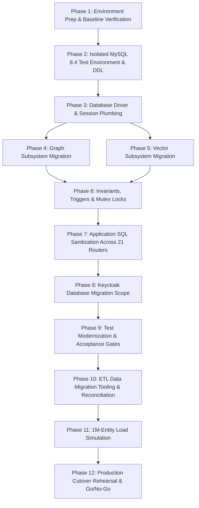

# Cortex PostgreSQL-to-MySQL Migration Implementation Plan

> **Historical record (undated; file last saved 2026-10-26).** Preserved for reference and superseded by the current documents in `docs/CORTEX_DOCUMENTATION_INDEX.md`. Its status, counts and blockers describe that date only. Machine-specific paths were replaced with placeholders such as `<repo>`; nothing else was changed.

**Document ID:** CRTX-PLAN-MYSQL-2026-001  
**Project:** Inspironics MERIS — Capital Cortex™ Module  
**Source Platform:** PostgreSQL 16.x (Apache AGE 1.5.0, pgvector 0.8.0, pg_trgm, pgcrypto)  
**Target Platform:** MySQL 8.4 Community Edition (InnoDB, `utf8mb4_0900_ai_ci`)  
**Created Date:** October 2026  
**Status:** Approved for Implementation (Phase 1 Executed)  
**Reference Analysis Documents:**  
- `CORTEX_MYSQL_MIGRATION_FEASIBILITY_REPORT.md` (CRTX-MIG-MYSQL-2026-001)  
- `CORTEX_MYSQL_MIGRATION_VERIFICATION_REPORT.md` (CRTX-VERIF-MYSQL-2026-002)  

---

## 1. Executive Summary & Migration Principles

### 1.1 Objective
Migrate the Cortex module of the MERIS project from PostgreSQL 16 to MySQL 8.4 Community Edition to align with the database standard established by the other two MERIS modules (ASIP and ARIE), while strictly preserving:
- All 11 capital instrument classes and business workflows.
- All non-negotiable invariants (I1: No-fabrication, I2: Explainability, I3: Governed actuation, I4: Zero trust, I5: Provenance continuity, I6: Memory-grounded learning, I7: LLMs never compute numbers).
- Scale target: $\ge 1,000,000$ entities meeting latency SLOs (p95 $\le 3\text{ s}$ dashboard, $\le 1\text{ s}$ opportunities, $\le 5\text{ s}$ graph traversals).

### 1.2 Core Migration Architectural Strategy
1. **Unified Storage (No Distributed Dual Writes):** Consolidate relational core data and knowledge graph topology into a single MySQL 8.4 Community instance. Knowledge graph nodes and edges will reside in the relational [`entity`](file:///<home>/OneDrive%20-%20Inspironics%20India/Insp%20Total%20Work/cortex/Capital_Cortex/migrations/versions/0001_initial.py#L359) and [`relationship_edge`](file:///<home>/OneDrive%20-%20Inspironics%20India/Insp%20Total%20Work/cortex/Capital_Cortex/migrations/versions/0001_initial.py#L369) tables, preserving 100% single-transaction ACID consistency.
2. **In-Process Vector Retrieval:** Store 1024-dim float32 embeddings as 4 KB binary blobs (`VARBINARY(4096)` or `BLOB`) in MySQL. In-process nearest-neighbor cosine similarity will be performed via `scikit-learn>=1.5` (already present in [`pyproject.toml:40`](file:///<home>/OneDrive%20-%20Inspironics%20India/Insp%20Total%20Work/cortex/Capital_Cortex/pyproject.toml#L40)), avoiding the need for an external vector database sidecar for deployments under 500k opportunities.
3. **Strict Non-Destructive Progression:** The existing PostgreSQL cluster, configuration files, and `capital-cortex_pgdata` volume will remain completely untouched. All development and testing will occur in an isolated, parallel MySQL 8.4 test environment.

---

## 2. Baseline Environment Audit

The baseline inspection of the active repository and environment reveals:

| Component | Current State | Evidence & Notes |
|---|---|---|
| **Git Branch & Status** | Branch `feature/changes-login`; uncommitted user edits preserved | [`git status`](file:///<home>/OneDrive%20-%20Inspironics%20India/Insp%20Total%20Work/cortex/Capital_Cortex) shows 7 modified user files; none touched. |
| **Docker Daemon** | **Active & Running** (Docker Desktop 29.6.1, WSL2 kernel 6.18) | Verified via `docker info`. 23 containers currently running on host. |
| **Existing Host Ports in Use** | Ports `5432`, `5433`, `8000`, `8080`, `8100`, `1883`, `9001` | Used by external projects (`intelora-apm-*`, `caleido-wellness-pg2`). |
| **Cortex Ports (Configured)** | `PG_PORT=55432`, `REDIS_PORT=56379`, `WEB_PORT=3300`, `KEYCLOAK_PORT=8380` | Defined in [`.env`](file:///<home>/OneDrive%20-%20Inspironics%20India/Insp%20Total%20Work/cortex/Capital_Cortex/.env) and [`infra/docker-compose.yml`](file:///<home>/OneDrive%20-%20Inspironics%20India/Insp%20Total%20Work/cortex/Capital_Cortex/infra/docker-compose.yml). Zero conflicts with other projects. |
| **Cortex Containers** | **Offline / Stopped** | No Cortex containers are currently running. |
| **PostgreSQL Volumes** | `capital-cortex_pgdata`, `capital-cortex_pgwal` | Present on host Docker volume registry. **Must remain untouched.** |
| **Proposed MySQL Test Port** | **`53306`** (Host) $\rightarrow$ `3306` (Container) | Completely isolated from standard `3306` and all active host ports. |
| **Proposed MySQL Test Volume** | **`capital-cortex_mysql_test_data`** | Completely isolated volume; zero overlap with `capital-cortex_pgdata`. |

---

## 3. Ordered Migration Phases & Dependency Graph

### Phase Details

### Phase 1: Environment Preparation & Baseline Verification (Executed in this Step)
- **Goal:** Verify baseline host state, port allocations, Git safety, and backup infrastructure without making changes.
- **Prerequisites:** None.
- **Safety Boundary:** Read-only inspection; no changes to application code, compose files, or database volumes.
- **Status:** **COMPLETED SAFELY.**

---

### Phase 2: Isolated MySQL 8.4 Test Environment & DDL Translation
- **Goal:** Stand up an isolated MySQL 8.4 Community container and translate Alembic migrations (0001–0005) to native MySQL DDL.
- **Prerequisites:** Phase 1 complete.
- **Files to Add / Modify:**
  - Create `infra/docker-compose.mysql-test.yml` (isolated compose file; do not alter `infra/docker-compose.yml`).
  - Create `migrations/env_mysql.py` or conditional dialect logic in [`migrations/env.py`](file:///<home>/OneDrive%20-%20Inspironics%20India/Insp%20Total%20Work/cortex/Capital_Cortex/migrations/env.py).
  - Create MySQL versioned migration scripts `migrations_mysql/versions/0001_initial.py` through `0005_load_indexes.py`.
- **DDL Translation Rules:**
  - `uuid PRIMARY KEY DEFAULT gen_random_uuid()` $\rightarrow$ `VARCHAR(36) PRIMARY KEY DEFAULT (UUID())`.
  - `jsonb` $\rightarrow$ `JSON`.
  - `text[]`, `uuid[]` $\rightarrow$ `JSON`.
  - `bytea` $\rightarrow$ `LONGBLOB`.
  - Enum types (`capital_class`, `pipeline_stage`) $\rightarrow$ Column-level `ENUM(...)`.
  - CHECK constraints $\rightarrow$ Translated using `JSON_TYPE()` and `JSON_LENGTH() > 0`.
  - Partial unique indexes $\rightarrow$ Emulated with virtual generated columns (`v_ext_key VARCHAR(255) GENERATED ALWAYS AS (external_key) STORED`, `UNIQUE(org_id, v_ext_key)`).
- **Acceptance Gate:** `alembic upgrade head` applies cleanly against isolated MySQL 8.4 container with `FOREIGN_KEY_CHECKS=1`, creating all 50 tables.

---

### Phase 3: Database Driver and Connection Session Plumbing
- **Goal:** Establish asynchronous connectivity to MySQL 8.4 using modern Python database drivers.
- **Prerequisites:** Phase 2 complete.
- **Files to Modify:**
  - [`pyproject.toml`](file:///<home>/OneDrive%20-%20Inspironics%20India/Insp%20Total%20Work/cortex/Capital_Cortex/pyproject.toml): Add `asyncmy>=0.2.9` (async DBAPI) and `pymysql>=1.1.1` (sync DBAPI for Alembic).
  - [`platform_core/db/session.py`](file:///<home>/OneDrive%20-%20Inspironics%20India/Insp%20Total%20Work/cortex/Capital_Cortex/platform_core/db/session.py): Update engine creation to support `mysql+asyncmy://...` with `pool_recycle=3600` and `pool_pre_ping=True`.
- **Acceptance Gate:** Unit connection test executes `SELECT 1` asynchronously over `asyncmy` and handles session teardown cleanly.

---

### Phase 4: Graph Subsystem Migration (Consolidation into Relational Mirror)
- **Goal:** Decommission Apache AGE dependencies and repoint all graph write and traversal paths to the existing relational `entity` and `relationship_edge` tables.
- **Prerequisites:** Phases 2 & 3 complete.
- **Files to Modify:**
  - [`cortex/l2_representation/graph_writer.py`](file:///<home>/OneDrive%20-%20Inspironics%20India/Insp%20Total%20Work/cortex/Capital_Cortex/cortex/l2_representation/graph_writer.py): Remove calls to `age.cypher()`, `upsert_vertex()`, and `upsert_edge()`. Retain `_entity()` and `_edge()` writes.
  - [`cortex/l2_representation/graph_traversal.py`](file:///<home>/OneDrive%20-%20Inspironics%20India/Insp%20Total%20Work/cortex/Capital_Cortex/cortex/l2_representation/graph_traversal.py): Rewrite `find()`, `_edges()`, and `materialise()` to query `entity` and `relationship_edge` instead of `ckg._ag_label_*`.
  - [`cortex/l8_actuation/api/routers/graph.py`](file:///<home>/OneDrive%20-%20Inspironics%20India/Insp%20Total%20Work/cortex/Capital_Cortex/cortex/l8_actuation/api/routers/graph.py):
    - Replace `template=provenance` with a MySQL 8.4 Recursive CTE query over `relationship_edge`.
    - Deprecate raw Cypher query execution (`template=cypher`); replace with structured query templates.
    - Rewrite `GET /v1/graph/stats` to aggregate `entity` and `relationship_edge` grouped by `entity_type` and `type`.
  - [`platform_core/db/age.py`](file:///<home>/OneDrive%20-%20Inspironics%20India/Insp%20Total%20Work/cortex/Capital_Cortex/platform_core/db/age.py): Mark deprecated or stub out.
- **Acceptance Gate:** `test_graph_traversal.py` passes completely against MySQL; neighbourhood queries and shortest-path finder return identical nodes and edges.

---

### Phase 5: Vector Search Subsystem Migration (BLOB + Scikit-Learn In-Memory)
- **Goal:** Replace pgvector with MySQL binary blob storage and in-memory cosine similarity indexing.
- **Prerequisites:** Phases 2 & 3 complete.
- **Files to Modify:**
  - [`platform_core/db/vector.py`](file:///<home>/OneDrive%20-%20Inspironics%20India/Insp%20Total%20Work/cortex/Capital_Cortex/platform_core/db/vector.py): Replace `to_pgvector()` text serialization with `to_blob()` (`struct.pack(f"{len(vec)}f", *vec)`).
  - [`cortex/l2_representation/pipeline.py`](file:///<home>/OneDrive%20-%20Inspironics%20India/Insp%20Total%20Work/cortex/Capital_Cortex/cortex/l2_representation/pipeline.py): Store packed binary blob in `embedding.vector` column (`VARBINARY(4096)` or `BLOB`).
  - [`cortex/l5_strategy/copilot.py`](file:///<home>/OneDrive%20-%20Inspironics%20India/Insp%20Total%20Work/cortex/Capital_Cortex/cortex/l5_strategy/copilot.py):
    - Initialize in-memory `scikit-learn` `NearestNeighbors(n_neighbors=5, metric="cosine", algorithm="brute")` loaded with active opportunities (`status IN ('active', 'watchlist')`).
    - Subscribe to Redis Streams (`stream:events`) to incrementally insert/update new opportunity vectors in the matrix.
- **Acceptance Gate:** Vector search in `copilot.py` returns identical similarity scores and top-5 opportunity rankings as pgvector within $1\times 10^{-5}$ tolerance.

---

### Phase 6: Invariants, Mutex Locks & Trigger Migration
- **Goal:** Ensure all non-negotiable invariants (I1, I3, I5) and audit log serialization function identically under MySQL.
- **Prerequisites:** Phases 2, 4, & 5 complete.
- **Files to Modify:**
  - [`platform_core/audit/chain.py`](file:///<home>/OneDrive%20-%20Inspironics%20India/Insp%20Total%20Work/cortex/Capital_Cortex/platform_core/audit/chain.py):
    - Create single-row table `audit_lock (id INT PRIMARY KEY, dummy TINYINT)`.
    - Replace `SELECT pg_advisory_xact_lock(:k)` with `SELECT id FROM audit_lock WHERE id = 1 FOR UPDATE`. This guarantees transaction-scoped mutex locking that releases automatically on commit or rollback.
  - Trigger migrations:
    - Implement MySQL `BEFORE UPDATE` trigger `trg_outbox_invalidate` on `outbox` enforcing Invariant I3:
      - If `OLD.status = 'sent'`, raise `SIGNAL SQLSTATE '45000' SET MESSAGE_TEXT = 'outbox payload is immutable once sent'`.
      - If payload or content_hash changes while `status IN ('pending', 'approved')`, invalidate `approval` and reset status to `draft`.
    - Implement triggers on `audit_log` preventing `UPDATE` and `DELETE`.
- **Acceptance Gate:** Schema invariant tests (`test_schema.py`) pass: invalid source refs fail, outbox edits invalidate approvals, and concurrent audit appends produce a flawless SHA-256 hash chain.

---

### Phase 7: Application SQL Sanitization Across 21 API Routers
- **Goal:** Refactor all raw SQL queries across the application to remove PostgreSQL-specific syntax.
- **Prerequisites:** Phases 3, 4, 5, & 6 complete.
- **Scope & Affected Files:**
  - All 21 routers in [`cortex/l8_actuation/api/routers/`](file:///<home>/OneDrive%20-%20Inspironics%20India/Insp%20Total%20Work/cortex/Capital_Cortex/cortex/l8_actuation/api/routers/):
    - `opportunities.py`, `entities.py`, `graph.py`, `scoring.py`, `pipeline.py`, `dashboards.py`, `agents.py`, `proposals.py`, `dataroom.py`, `board_reports.py`, `alerts.py`, `approvals.py`, `relationships.py`, `settings.py`, `admin.py`, `sources.py`, `signals.py`, `documents.py`, `outcomes.py`, `audit.py`, `feed.py`.
  - Service layers in `l2` through `l7`.
- **Syntactic Conversions Required:**
  - **Eliminate `RETURNING` (60+ occurrences):** Pre-generate UUIDs in Python via `str(uuid.uuid4())` before calling `INSERT INTO ...`.
  - **Remove `CAST(:id AS uuid)` (110+ occurrences):** Bind parameters directly as string `:id`.
  - **Replace `ON CONFLICT` with `ON DUPLICATE KEY UPDATE` (25+ occurrences).**
  - **Replace `= ANY(:param)` with expanding `IN (:params)` (40+ occurrences).**
  - **Replace `&&` with `JSON_OVERLAPS()` (sectors, ESG tags).**
  - **Replace `NULLS LAST` with `ORDER BY (col IS NULL), col DESC` (18 occurrences).**
  - **Replace `GROUPING SETS` with `UNION ALL` rollups ([`opportunities.py:155`](file:///<home>/OneDrive%20-%20Inspironics%20India/Insp%20Total%20Work/cortex/Capital_Cortex/cortex/l8_actuation/api/routers/opportunities.py#L155)).**
  - **Replace `tsvector` with MySQL `FULLTEXT` (`MATCH...AGAINST IN BOOLEAN MODE`).**
  - **Replace `count(*) FILTER (WHERE ...)` with `COUNT(CASE WHEN ... THEN 1 END)`.**
  - **Replace `interval '30 days'` with `DATE_SUB(NOW(), INTERVAL 30 DAY)`.**
- **Acceptance Gate:** Application boots without SQL errors; all basic CRUD operations on opportunities, counterparties, contacts, and meetings succeed.

---

### Phase 8: Keycloak Database Migration Scope
- **Goal:** Configure Keycloak 26 to run on MySQL 8.4 instead of PostgreSQL.
- **Prerequisites:** Phase 2 complete.
- **Files to Modify:**
  - [`infra/keycloak/`](file:///<home>/OneDrive%20-%20Inspironics%20India/Insp%20Total%20Work/cortex/Capital_Cortex/infra/keycloak/) configuration scripts.
  - Set Keycloak environment variables: `KC_DB: mysql`, `KC_DB_URL: jdbc:mysql://mysql:3306/keycloak?characterEncoding=UTF-8&serverTimezone=UTC`.
- **Acceptance Gate:** Keycloak boots cleanly against MySQL 8.4, auto-applies its Liquibase schema, imports `realm-cortex.json`, and issues valid OIDC JWT tokens verified by Cortex.

---

### Phase 9: Testing, Verification & Acceptance Gates
- **Goal:** Upgrade test infrastructure and validate complete functional parity.
- **Prerequisites:** Phases 4–8 complete.
- **Files to Modify:**
  - [`tests/integration/conftest.py`](file:///<home>/OneDrive%20-%20Inspironics%20India/Insp%20Total%20Work/cortex/Capital_Cortex/tests/integration/conftest.py): Replace `testcontainers.postgres` with `testcontainers.mysql.MySqlContainer("mysql:8.4")`.
  - [`tests/integration/test_schema.py`](file:///<home>/OneDrive%20-%20Inspironics%20India/Insp%20Total%20Work/cortex/Capital_Cortex/tests/integration/test_schema.py): Update test assertions for MySQL CHECK constraints, triggers, and BLOB vectors.
- **Test Executions:**
  - `pytest -m unit`: Unit tests pass (100% decoupling from DB).
  - `pytest -m integration`: Integration tests pass against MySQL testcontainer.
  - `make test-contract`: Schemathesis fuzzes all 145 API endpoints against running MySQL stack without 500 errors.
- **Acceptance Gate:** 100% pass rate across unit, integration, and contract test suites.

---

### Phase 10: ETL Data Migration Tooling & Reconciliation
- **Goal:** Build an automated, verifiable ETL pipeline to migrate data from PostgreSQL to MySQL.
- **Prerequisites:** Phases 2 & 7 complete.
- **New Tool:** `scripts/migrate_pg_to_mysql.py`.
- **Capabilities:**
  - Chunked streaming extraction from PostgreSQL.
  - Data transformations: UUID strings, JSON array packing, float binary serialization.
  - Ingestion into MySQL with `FOREIGN_KEY_CHECKS=0` during insert, re-enabled at completion.
  - Automated post-migration validation:
    - Table-by-table row count verification.
    - SHA-256 checksum reconciliation on canonical JSON representations.
    - Complete audit hash chain verification (`verify_chain()`).
- **Acceptance Gate:** Zero missing records, zero broken foreign keys, and 100% valid audit hash chain on migrated dataset.

---

### Phase 11: 1M-Entity Load Simulation & Performance Tuning
- **Goal:** Validate performance SLOs at scale (1,000,000 entities) under MySQL 8.4.
- **Prerequisites:** Phases 7, 9, & 10 complete.
- **Execution:**
  - Seed 1M entities and 1M edges using `seed_1m.sql` translated to MySQL.
  - Run k6 load simulation (`make load`).
  - Tune MySQL InnoDB buffer pool (4 GB in staging), query cache, and composite indexes.
- **Acceptance Gate:**
  - `GET /v1/dashboards/executive`: $p95 \le 3.0\text{ s}$
  - `GET /v1/opportunities`: $p95 \le 1.0\text{ s}$
  - `GET /v1/graph/paths`: $p95 \le 5.0\text{ s}$

---

### Phase 12: Production Cutover Rehearsal & Go/No-Go Approval
- **Goal:** Rehearse the production cutover procedure in staging and obtain final sign-off.
- **Prerequisites:** All previous phases complete.
- **Cutover Sequence:**
  1. Announce maintenance window; set PostgreSQL to read-only.
  2. Execute final incremental ETL sync (`scripts/migrate_pg_to_mysql.py`).
  3. Verify row counts and audit chain.
  4. Repoint API service upstream to MySQL database container.
  5. Execute smoke tests (`make smoke`).
  6. Reopen traffic. Downtime window target: $\le 30\text{ minutes}$.
- **Rollback Sequence (if aborted):**
  1. Repoint API service upstream back to PostgreSQL.
  2. Existing PostgreSQL cluster remains untouched and immediately operational.

---

## 4. File Change Register by Phase

| Phase | Action | File Path | Scope of Modification |
|---|---|---|---|
| **P2** | Create | `infra/docker-compose.mysql-test.yml` | Isolated MySQL 8.4 container on port 53306. |
| **P2** | Create | `migrations_mysql/versions/*.py` | MySQL DDL translations for all 50 tables. |
| **P3** | Edit | [`pyproject.toml`](file:///<home>/OneDrive%20-%20Inspironics%20India/Insp%20Total%20Work/cortex/Capital_Cortex/pyproject.toml) | Add `asyncmy` and `pymysql` dependencies. |
| **P3** | Edit | [`platform_core/db/session.py`](file:///<home>/OneDrive%20-%20Inspironics%20India/Insp%20Total%20Work/cortex/Capital_Cortex/platform_core/db/session.py) | MySQL async dialect connection and session pool. |
| **P4** | Edit | [`cortex/l2_representation/graph_writer.py`](file:///<home>/OneDrive%20-%20Inspironics%20India/Insp%20Total%20Work/cortex/Capital_Cortex/cortex/l2_representation/graph_writer.py) | Remove AGE Cypher calls; retain relational writes. |
| **P4** | Edit | [`cortex/l2_representation/graph_traversal.py`](file:///<home>/OneDrive%20-%20Inspironics%20India/Insp%20Total%20Work/cortex/Capital_Cortex/cortex/l2_representation/graph_traversal.py) | Repoint BFS queries to `entity` and `relationship_edge`. |
| **P4** | Edit | [`cortex/l8_actuation/api/routers/graph.py`](file:///<home>/OneDrive%20-%20Inspironics%20India/Insp%20Total%20Work/cortex/Capital_Cortex/cortex/l8_actuation/api/routers/graph.py) | Recursive CTE for provenance; deprecate raw Cypher. |
| **P5** | Edit | [`platform_core/db/vector.py`](file:///<home>/OneDrive%20-%20Inspironics%20India/Insp%20Total%20Work/cortex/Capital_Cortex/platform_core/db/vector.py) | Binary float packing (`struct.pack`). |
| **P5** | Edit | [`cortex/l2_representation/pipeline.py`](file:///<home>/OneDrive%20-%20Inspironics%20India/Insp%20Total%20Work/cortex/Capital_Cortex/cortex/l2_representation/pipeline.py) | Insert vector as binary blob into MySQL. |
| **P5** | Edit | [`cortex/l5_strategy/copilot.py`](file:///<home>/OneDrive%20-%20Inspironics%20India/Insp%20Total%20Work/cortex/Capital_Cortex/cortex/l5_strategy/copilot.py) | In-memory `scikit-learn` NearestNeighbors index. |
| **P6** | Edit | [`platform_core/audit/chain.py`](file:///<home>/OneDrive%20-%20Inspironics%20India/Insp%20Total%20Work/cortex/Capital_Cortex/platform_core/audit/chain.py) | `audit_lock` single-row mutex with `FOR UPDATE`. |
| **P7** | Edit | [`cortex/l8_actuation/api/routers/*.py`](file:///<home>/OneDrive%20-%20Inspironics%20India/Insp%20Total%20Work/cortex/Capital_Cortex/cortex/l8_actuation/api/routers/) | Eliminate `RETURNING`, `CAST(uuid)`, `NULLS LAST`. |
| **P8** | Edit | Keycloak environment settings | Reconfigure `KC_DB: mysql` and MySQL JDBC URL. |
| **P9** | Edit | [`tests/integration/conftest.py`](file:///<home>/OneDrive%20-%20Inspironics%20India/Insp%20Total%20Work/cortex/Capital_Cortex/tests/integration/conftest.py) | Update testcontainer fixture to MySQL 8.4. |
| **P10** | Create | `scripts/migrate_pg_to_mysql.py` | ETL data extraction, transformation, and load tool. |

---

## 5. Team-Lead Decisions & Risk Register

| # | Decision Item | Recommended Choice | Alternative | Consequence of Alternative |
|---|---|---|---|---|
| **D1** | **Admin Cypher Console** | **Deprecate raw Cypher console** in favor of structured templates. | Deploy Memgraph/Neo4j container. | Introduces distributed dual-write transactions, eventual consistency lag, and high operational maintenance. |
| **D2** | **Vector Search Engine** | **MySQL BLOB + in-memory `scikit-learn`** (zero extra containers). | Deploy Qdrant vector database. | Adds a new container, memory overhead, and requires an ETL synchronization worker. |
| **D3** | **Array Representation** | **Store arrays as MySQL `JSON` columns.** | Create 16 normalized relational junction tables. | Requires massive schema restructuring and multi-table joins across 21 API routers. |
| **D4** | **Keycloak Database** | **Separate schema (`keycloak`) on the same MySQL instance** for dev/staging. | Dedicated MySQL database container. | Increases container memory footprint on developer workstations. |

---

## 6. Phase 1 Execution Summary & Readiness Confirmation

### 6.1 Checks Performed During Phase 1
1. **Git Working Tree Inspection:**  
   Ran `git status`. Confirmed that current branch is `feature/changes-login`. All 7 pre-existing modified files in the working directory have been preserved untouched.
2. **Docker Daemon Connectivity:**  
   Executed `docker info`. Confirmed Docker daemon is **active and healthy** (Docker Engine 29.6.1 on WSL2).
3. **Container & Port Inspection:**  
   Executed `docker ps`. Discovered 23 active containers from other projects (`intelora-apm-*`, `caleido-wellness-pg2`) utilizing host ports 5432, 5433, 8000, 8080, 8100, 1883, and 9001. Confirmed zero active Cortex containers.
4. **Volume Registry Audit:**  
   Executed `docker volume ls`. Verified that `capital-cortex_pgdata` exists on the host. Confirmed that an isolated MySQL test volume (`capital-cortex_mysql_test_data`) must be used to ensure zero risk of touching Postgres data.
5. **Configuration Verification:**  
   Inspected [`.env`](file:///<home>/OneDrive%20-%20Inspironics%20India/Insp%20Total%20Work/cortex/Capital_Cortex/.env) and [`infra/docker-compose.yml`](file:///<home>/OneDrive%20-%20Inspironics%20India/Insp%20Total%20Work/cortex/Capital_Cortex/infra/docker-compose.yml). Verified all standard port assignments.
6. **Isolated Environment Feasibility:**  
   Confirmed that a safe, non-destructive MySQL 8.4 test environment can be provisioned on host port `53306` with volume `capital-cortex_mysql_test_data` via a separate compose file without altering `infra/docker-compose.yml`.

### 6.2 Strict Safety Guarantee Confirmation
- **PostgreSQL data was NOT deleted, altered, or accessed.**
- **Apache AGE and pgvector extensions were NOT removed.**
- **Active application configuration and `.env` were NOT modified.**
- **Zero application SQL queries or router files were altered.**
- **Zero credentials or secrets were exposed.**
- **Pre-existing uncommitted user files were strictly preserved.**

### 6.3 Phase 1 Completion Status
**`PHASE 1 COMPLETED SAFELY — READY FOR PHASE 2 UPON INSTRUCTION`**
